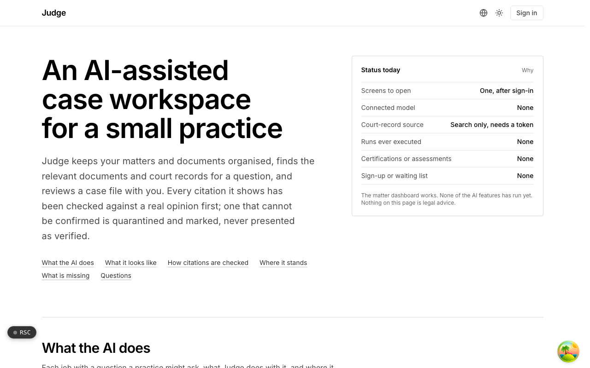

  <picture>
    <source media="(prefers-color-scheme: dark)" srcset=".github/assets/hero-dark.png">
    
  </picture>

# judge.me.at

An AI-assisted case workspace for a small practice.

Judge keeps a small legal practice's matters and documents organised, finds the relevant documents and court records for a question, and reviews a case file with you. It joins public court-record integrations with a firm's own files behind privilege, PII, provenance and rate-budget safeguards. Every citation it shows must be checked against a real opinion first; one that cannot be confirmed is quarantined and marked, never presented as verified. Judge is in active development: the matter dashboard works today, and the AI features have not yet run against a connected model. Nothing here is legal advice.

## Features

- **A matter dashboard, behind sign-in**: firms, clients, matters, calendar dates and a document archive searchable by words and tags.
- **A wall around each matter**: a matter is readable only by the people on its access list, and archive search applies that list inside the query.
- **Privilege-aware documents**: a privileged document's text never reaches the search index, and stays out of any AI run unless an attorney names it for that run.
- **Citation checking with quarantine**: citations are extracted from generated text and must verify before they render as verified, tested against deliberately fake citations.
- **Deadlines from the court or from you**: a calendar date is court-supplied or user-entered; computing one from a procedural rule is refused.
- **Opinion search, scoped to a matter**: case law search runs inside a matter the caller may read, against a daily request budget.
- **Answers bound to the record**: drafts (chronology, outline, summary, timeline) must rest on passages retrieved from the matter, and refuse rather than guess.

## Built with

- Next.js 16 (App Router), React 19, TypeScript
- Tailwind CSS 4
- oRPC for the typed API
- Drizzle ORM + Postgres
- Better Auth (the shared me.at account)

## Part of the me.at family

judge.me.at is one of the [`*.me.at`](https://me.at) apps by Trevor McDougald. They share one design system, account, and app shell. Development happens in a private monorepo; this repository is the project's public-facing home.

## License

See [LICENSE](LICENSE).
