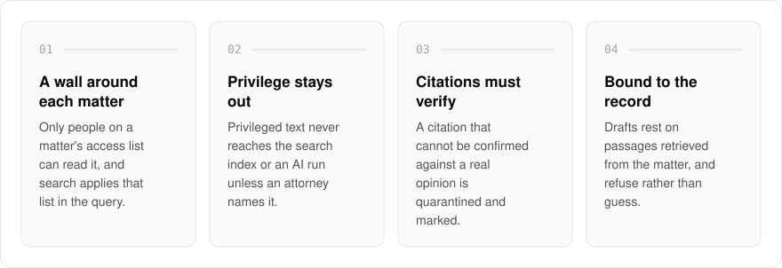
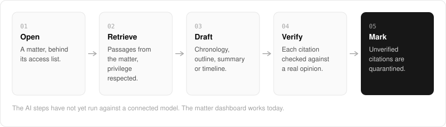

  <picture>
    <source media="(prefers-color-scheme: dark)" srcset=".github/assets/hero-dark.png">
    
  </picture>

<h1 align="center">judge.me.at</h1>

<strong>AI-assisted case workspaces for law practices.</strong>

  
  
  

  <a href="#features">Features</a> ·
  <a href="#how-it-works">How it works</a> ·
  <a href="#built-with">Built with</a>

A small practice cannot afford an AI tool that leaks privileged documents or cites a case that does not exist. I built judge.me.at to keep a practice's matters and documents organised, find the relevant documents and court records for a question, and review a case file with you. It joins public court-record integrations with a firm's own files behind privilege, PII, provenance and rate-budget safeguards. Every citation it shows must be checked against a real opinion first, and one that cannot be confirmed is quarantined and marked, never presented as verified.

> **Status:** in development. The matter dashboard works today, and the AI features have not yet run against a connected model. Nothing here is legal advice.

  <picture>
    <source media="(prefers-color-scheme: dark)" srcset=".github/assets/overview-dark.svg">
    
  </picture>

## Why judge.me.at

| The usual AI legal assistant | judge.me.at |
| --- | --- |
| Shows citations as it generated them | Quarantines any citation it cannot verify |
| Reads every document you upload | Keeps privileged text out unless an attorney names it for the run |
| Answers from general knowledge | Drafts only from passages retrieved from the matter, or refuses |
| Computes deadlines from procedural rules | Uses only court-supplied or user-entered dates |

## Features

- **A matter dashboard, behind sign-in**: firms, clients, matters, calendar dates and a document archive searchable by words and tags.
- **A wall around each matter**: a matter is readable only by the people on its access list, and archive search applies that list inside the query.
- **Privilege-aware documents**: a privileged document's text never reaches the search index, and stays out of any AI run unless an attorney names it for that run.
- **Citation checking with quarantine**: citations are extracted from generated text and must verify before they render as verified, tested against deliberately fake citations.
- **Deadlines from the court or from you**: a calendar date is court-supplied or user-entered. Computing one from a procedural rule is refused.
- **Opinion search, scoped to a matter**: case law search runs inside a matter the caller may read, against a daily request budget.
- **Answers bound to the record**: drafts (chronology, outline, summary, timeline) must rest on passages retrieved from the matter, and refuse rather than guess.

## How it works

  <picture>
    <source media="(prefers-color-scheme: dark)" srcset=".github/assets/flow-dark.svg">
    
  </picture>

Everything starts inside a matter, readable only by the people on its access list. A question retrieves passages from that matter, with privileged text left out unless an attorney names it, and a draft must rest on those passages or refuse. Every citation in the draft is then checked against a real opinion, and any that cannot be confirmed is quarantined and marked rather than shown as verified.

## Built with

  
  
  
  
  

- Next.js 16 (App Router), React 19, TypeScript
- Tailwind CSS 4
- oRPC for the typed API
- Drizzle ORM + Postgres
- Better Auth (the shared me.at account)

## Part of the me.at family

judge.me.at is one of my [`*.me.at`](https://me.at) apps. They share one design system, account, and app shell. Development happens in a private monorepo; this repository is the project's public-facing home.

## License

Source-available. See [LICENSE](LICENSE).
